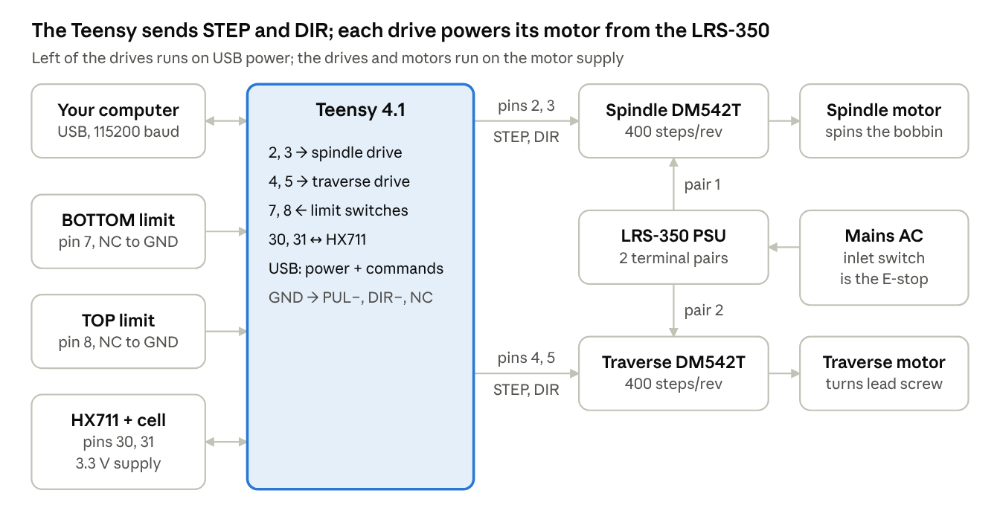
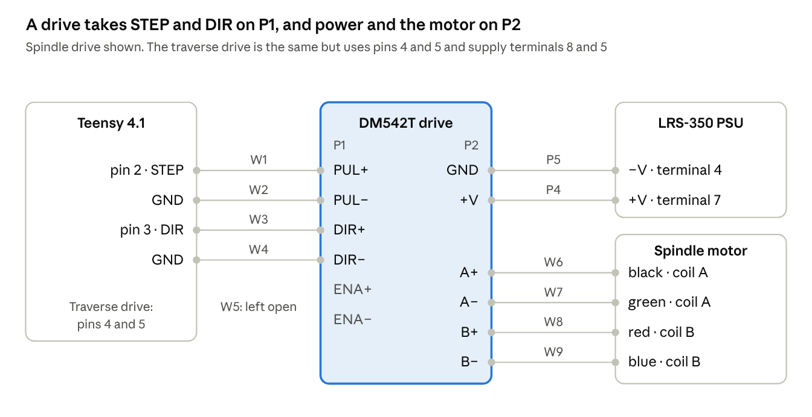

# Open Winder — Build & Wiring Guide

Pazzatronics · Last updated October 12, 2026

**Disclaimer.** I wrote this guide with the help of Claude, an AI assistant, and read it over myself, but it may still contain errors. Check every connection and setting against the parts' own datasheets and the files in the repo before you power anything. Don't attempt this project if you have no wiring or coding experience, or if you don't know how to work safely around mains electricity. This guide does not provide safety instruction. You build and use it entirely at your own risk, and I am not liable for any damage, injury or loss that results.

## How it works

Open Winder is a two-axis machine: a spindle motor spins the bobbin while a traverse motor moves the wire guide back and forth across it, both timed by a Teensy 4.1.¹ Two limit switches mark the ends of the guide's travel, and a load cell measures wire tension.

The traverse is geared to the spindle in software. Each spindle step adds 1/400 of the pitch (`space`) to a running total, and the traverse takes one 12.5 µm step each time that total reaches 12.5 µm.¹ That keeps the pitch the same at any speed, including while the spindle speeds up and slows down.



Everything left of the drives runs on USB power; the drives and motors run on the LRS-350. The drives' inputs are optically isolated, so the two sides meet only through the STEP and DIR signals.⁶

## Parts list

Open Winder needs one controller, two stepper drives, two stepper motors, one motor power supply and three sensors; everything else is printed or off-the-shelf hardware.¹,²

| Part | Qty | What it does in the winder | Key specs |
| --- | --- | --- | --- |
| Teensy 4.1 (PJRC) | 1 | The brain. Runs the firmware, takes your typed commands over USB, sends every motor step, and reads the switches and the load cell | 600 MHz; 3.3 V input/output pins. Never put 5 V on a pin |
| DM542T stepper drive | 2 | The muscle. Turns the Teensy's small STEP and DIR signals into high current in the motor coils. One drives the spindle, one the traverse | 20–50 V DC in; 1.0–4.2 A peak, set by DIP switch; optically isolated inputs⁶ |
| Spindle (winder) motor, NEMA 23 23HS45-4204S | 1 | Spins the bobbin. Every turn of this motor is one turn of wire | 4.2 A per phase, 3 Nm, 0.88 Ω, 3.4 mH, 1.8° per full step, 4 leads⁷ |
| Traverse motor | 1 | Turns the lead screw that moves the wire guide back and forth across the bobbin | Fits the traverse motor brackets; wire colours in this guide are for a 23HS45-4204S² |
| Lead screw, nut and carriage | 1 set | Turns motor rotation into straight-line movement of the wire guide | 5 mm lead (travel per screw turn) is the firmware default¹ |
| Mean Well LRS-350-24 power supply | 1 | Motor power for both drives. Logic runs from USB, not from this supply | 24 V, 14.6 A, 350 W; output adjustable 21.6–28.8 V; 115/230 V input selector switch⁸ |
| Mains inlet with switch and fuse | 1 | Feeds the power supply. Its switch is the emergency stop on the reference build | Rated for the supply's input current (6.8 A at 115 V AC)²,⁸ |
| Limit switch with normally closed (NC) contact | 2 | Mark the two hard ends of carriage travel, BOTTOM and TOP. Calibration finds them every run | Mechanical or optical, NC output³ |
| HX711 load-cell amplifier board | 1 | Reads the load cell's tiny signal and turns it into a 24-bit number for the Teensy | Powered from the Teensy's 3.3 V pin² |
| 1 kg parallel-beam load cell | 1 | Measures wire tension. The wire's pull bends the beam slightly | 1.0 mV/V output; 75 × 12.7 × 12.7 mm; four M4 holes; red / black / green / white leads⁹ |
| Micro-USB data cable | 1 | Powers the Teensy and carries commands from your computer | Must carry data, not charge-only |
| Printed parts, PETG | 1 set | Housing, clamps, motor brackets, limit-switch housings, tension-sensor housing | STLs in `hardware/stl`; editable STEP and Fusion 360 files alongside⁴ |
| Wire | — | Motor and supply runs; low-current signal runs | Motor and supply: no lighter than the motor's own AWG 20 leads.⁷ Signals: any thin hookup wire |
| Run-permit switch, snag sensor | Optional | Extra safety inputs. Supported in firmware but switched off by default | See Optional hardware¹ |

**Printed parts.** The STL folder holds the housing, top and bottom clamps, front and rear *top* motor brackets for both axes, both limit-switch housings, and the tension-sensor housing. The *bottom* motor brackets are in the STEP folder only, so export those four to STL before printing.⁴ All parts are printed in PETG.⁴

**Where to buy.** Amazon links for the traverse, motors, drives, power supply, power cable, load cell, limit switches, Teensy 4.1 and coupling are in the [README parts list](../README.md#parts-list) and the [bill of materials](../hardware/bom.md). If you're buying parts, please use them. They're affiliate links, so your price doesn't change and a small commission helps keep new projects and videos coming. *As an Amazon Associate I earn from qualifying purchases.*

## Before you wire

This guide covers connections and settings, not safety. Don't start the wiring unless you already know how to work safely around electricity, and verify everything here for yourself (see the disclaimer at the top).

**Tools:** multimeter, small flat screwdriver, wire strippers, crimp ferrules for the screw terminals (recommended), and a computer with the Arduino IDE and Teensyduino.

**How to read this guide**

- **Pin** means the number printed next to the hole on the Teensy 4.1.
- **Terminal** names (PUL+, DIR−, A+, +V and so on) are exactly as printed on the DM542T's two connectors.⁶
- **Wire IDs** (P1, W1, T1, L1, H1, O1, C1) match the rows of `hardware/wiring/open_winder_wiring.csv` in the repo, so you can tick wires off a spreadsheet as you go.²
- **BOTTOM and TOP** are the two ends of the carriage's travel. The firmware's "toward TOP" direction is set by the traverse DIR signal being HIGH.¹
- Keep STEP/DIR signal wires apart from motor wires. The drive manual says bundling them together causes position errors.⁶

## Power wiring

The LRS-350 powers only the two drives; the Teensy and the load cell run from the USB cable. Each drive gets its own pair of supply terminals, because the DM542T manual warns that daisy-chaining drive power causes interference between drives.²,⁶

**LRS-350 terminal numbers**, from the datasheet's pin assignment: 1 = AC/L, 2 = AC/N, 3 = FG (earth), 4–6 = DC −V, 7–9 = DC +V.⁸

**Input selector.** The LRS-350 has a switch that selects 115 V or 230 V AC input; set it to match your mains supply.⁸

| ID | From | To | Carries | Notes |
| --- | --- | --- | --- | --- |
| P1 | Mains live, through the switched and fused inlet | LRS-350 terminal 1 (AC/L) | AC live | The inlet switch is the emergency stop |
| P2 | Mains neutral | LRS-350 terminal 2 (AC/N) | AC neutral |  |
| P3 | Mains earth | LRS-350 terminal 3 (FG) | Protective earth | Also bond the machine frame to earth |
| P4 | LRS-350 terminal 7 (+V) | Winder DM542T **+V** | Motor supply + |  |
| P5 | LRS-350 terminal 4 (−V) | Winder DM542T **GND** | Motor supply return |  |
| P6 | LRS-350 terminal 8 (+V) | Traverse DM542T **+V** | Motor supply + | A different +V terminal from P4 |
| P7 | LRS-350 terminal 5 (−V) | Traverse DM542T **GND** | Motor supply return | A different −V terminal from P5 |
| P8 | Teensy micro-USB socket | Your computer | 5 V for the Teensy and the serial command link | 115200 baud |

- **Voltage.** The LRS-350-24 puts out 24 V and can be trimmed from 21.6 to 28.8 V with its ADJ screw.⁸ The DM542T accepts 20–50 V, and its manual suggests 20–45 V to leave room for the motor's back-voltage.⁶ More voltage mostly buys torque at higher speed.
- **Current.** A drive draws less from the supply than the motor current it is set to; the manual puts it at roughly 50–70 % of the motor current.⁶ Two drives fit comfortably inside the supply's 14.6 A.⁸
- **No ground link to the Teensy.** The wiring list has no wire between the supply's −V and the Teensy's GND. The drives' optically isolated inputs keep the logic side and the motor side separate.²,⁶
- **Using the emergency stop.** Switching off the mains inlet stops both motors at once, but the Teensy stays powered from USB and does not know the motors stopped. Send `stop`, then recalibrate before the next wind.

## Teensy 4.1 pin map

Eight Teensy pins carry signals, plus GND and 3.3 V; two more pins are reserved for optional safety inputs that are switched off in the firmware.¹,² Every pin number is a named constant near the top of the sketch (lines 151–165), so moving a wire to another pin is a one-line code change.¹

| Pin | In / out | Connects to (wire ID) | What the signal does | Constant (line) |
| --- | --- | --- | --- | --- |
| 2 | Out | Winder DM542T **PUL+** (W1) | One 5 µs HIGH pulse per spindle step. The drive moves on the rising edge | `PIN_WINDER_STEP` (151) |
| 3 | Out | Winder DM542T **DIR+** (W3) | Spindle direction. HIGH = clockwise | `PIN_WINDER_DIR` (152) |
| 4 | Out | Traverse DM542T **PUL+** (T1) | One pulse per carriage step | `PIN_TRAV_STEP` (153) |
| 5 | Out | Traverse DM542T **DIR+** (T3) | Carriage direction. HIGH = toward TOP | `PIN_TRAV_DIR` (154) |
| 7 | In (pull-up) | BOTTOM limit switch **COM** (L1) | LOW at rest, HIGH when the switch is pressed | `PIN_BOTTOM_LIMIT` (156) |
| 8 | In (pull-up) | TOP limit switch **COM** (L3) | LOW at rest, HIGH when the switch is pressed | `PIN_TOP_LIMIT` (157) |
| 30 | In (pull-up) | HX711 **DT** / DOUT (H3) | Data from the amplifier. LOW = a new reading is ready | `PIN_HX711_DT` (164) |
| 31 | Out | HX711 **SCK** (H4) | Clock pulses that shift the reading out. Idles LOW | `PIN_HX711_SCK` (165) |
| 33 | In (pull-up), optional | Run-permit switch (O1) | LOW = run allowed. Ignored unless enabled in code | `PIN_RUN_PERMIT` (159) |
| 34 | In (pull-up), optional | Snag sensor output (O3) | LOW = OK. Ignored unless enabled in code | `PIN_SNAG_FAULT` (160) |
| GND | — | Both drives' **PUL−** and **DIR−** (W2, W4, T2, T4); both limit switches' **NC** (L2, L4); HX711 **GND** (H2) | Common return for every signal | — |
| 3.3V | Out | HX711 **VCC** (and **VDD** if fitted) (H1) | Powers the amplifier and load cell | — |

- That is seven wires to GND. The Teensy 4.1 has several GND pins and any of them works; a small terminal strip as a ground bus keeps it tidy.
- "Pull-up" means the firmware turns on a weak internal resistor that holds the pin HIGH whenever nothing pulls it LOW, like a spring-loaded door that stays shut until something pushes it.
- Clockwise and "toward TOP" can be swapped in code without rewiring: `WINDER_DIR_INVERT` and `TRAVERSE_DIR_INVERT` at lines 167–168.¹

## Drive and motor wiring

Both axes are wired the same way; the only difference is which Teensy pins and which supply terminals they use.²

**Terms used here**

- **Step:** one small, fixed rotation of the motor shaft. These motors make 200 full steps per turn (1.8° each).⁷ Think of a ratchet that clicks forward one tooth per pulse.
- **Microstepping and steps/rev:** the drive splits each full step into smaller ones. At "microstep 2" it takes 400 pulses to turn the shaft once. That number, set on the DIP switches, must match the code.⁶
- **STEP (PUL) and DIR:** STEP is a short pulse; each rising edge (LOW to HIGH) moves the motor one step. DIR is a steady HIGH or LOW that picks the direction, and it must be set before the pulse, like a turn signal before a turn.
- **Common-cathode wiring:** both minus inputs (PUL−, DIR−) go to Teensy GND and the Teensy drives the plus inputs HIGH. The DM542T manual calls this the "PNP / common-cathode" connection.⁶

**DM542T connectors.** The drive has two screw connectors: **P1** (control signals: PUL+, PUL−, DIR+, DIR−, ENA+, ENA−) and **P2** (power and motor: GND, +V, A+, A−, B+, B−).⁶

| DM542T terminal | Spindle (winder) drive → | Traverse drive → | Notes |
| --- | --- | --- | --- |
| P1 **PUL+** | Teensy pin 2 (W1) | Teensy pin 4 (T1) | Step pulse in |
| P1 **PUL−** | Teensy GND (W2) | Teensy GND (T2) | Step return |
| P1 **DIR+** | Teensy pin 3 (W3) | Teensy pin 5 (T3) | Direction in |
| P1 **DIR−** | Teensy GND (W4) | Teensy GND (T4) | Direction return |
| P1 **ENA+ / ENA−** | Not connected (W5) | Not connected (T5) | Left open, the drive is always enabled⁶ |
| P2 **GND** | LRS-350 −V, terminal 4 (P5) | LRS-350 −V, terminal 5 (P7) | Supply return |
| P2 **+V** | LRS-350 +V, terminal 7 (P4) | LRS-350 +V, terminal 8 (P6) | Supply + |
| P2 **A+** | Motor **black** (W6) | Motor **black** (T6) | Coil A |
| P2 **A−** | Motor **green** (W7) | Motor **green** (T7) | Coil A |
| P2 **B+** | Motor **red** (W8) | Motor **red** (T8) | Coil B |
| P2 **B−** | Motor **blue** (W9) | Motor **blue** (T9) | Coil B |



Each dot is a screw terminal. ENA+ and ENA− stay empty, which leaves the drive permanently enabled.⁶

**Check the coil pairs before connecting.** On the 23HS45-4204S, black + green are one coil and red + blue the other, matching the maker's drawing (BLK A+, GRN A−, RED B+, BLU B−).³,⁷ The common black/red, blue/green pairing does **not** apply to this motor.³ With a meter, each pair should read about 0.9 Ω and the two pairs should be open to each other.⁷ For a different motor, the two leads that read a few ohms between them are one coil.

**If a motor turns the wrong way,** either swap the two leads of one coil (A+ with A−) with the power off, or flip its invert constant in the code (lines 167–168).¹,⁶

**Signal timing and levels**

- The DM542T needs DIR stable at least 5 µs before the step edge, and each pulse at least 2.5 µs HIGH and 2.5 µs LOW.⁶ The firmware sends 5 µs pulses with 5 µs of DIR setup, plus 60 µs of extra DIR settling whenever the traverse reverses (lines 174, 175, 182).¹
- Each input draws 7–16 mA, and the drive accepts up to 200 kHz of pulses.⁶
- The manual specifies 4–5 V for a HIGH input. The Teensy drives 3.3 V, which works on the reference build but is below spec.²,⁶

## DM542T DIP switch settings

Set both drives to 400 steps/rev (SW5 OFF, SW6 ON, SW7 ON, SW8 ON) before power-up; current is set separately per drive.²,⁶ Change switches only with the power off.

| Switches | Spindle drive | Traverse drive | What they set |
| --- | --- | --- | --- |
| SW1 / SW2 / SW3 | OFF / OFF / OFF = 4.20 A peak (3.00 A RMS) | OFF / OFF / ON = 2.37 A peak (1.69 A RMS) | Motor current while moving⁶ |
| SW4 | OFF | OFF | OFF = current drops to half 0.4 s after the last pulse, so a resting motor runs cooler⁶ |
| SW5 / SW6 / SW7 / SW8 | OFF / ON / ON / ON | OFF / ON / ON / ON | Microstep 2 = 400 steps/rev. Must equal `WINDER_STEPS_PER_REV` (line 212) and `TRAV_STEPS_PER_REV` (line 204)¹,⁶ |

The spindle runs at the motor's full 4.20 A rating, as in the repo's wiring notes.³ The traverse only pushes a light carriage, so a lower current is plenty and keeps that motor cool; 2.37 A is a good starting point. If the traverse loses steps, go one setting higher.

**Current settings, SW1–SW3.** From the DM542T manual.⁶

| Peak | RMS | SW1 | SW2 | SW3 |
| --- | --- | --- | --- | --- |
| 1.00 A | 0.71 A | ON | ON | ON |
| 1.46 A | 1.04 A | OFF | ON | ON |
| 1.91 A | 1.36 A | ON | OFF | ON |
| 2.37 A | 1.69 A | OFF | OFF | ON |
| 2.84 A | 2.03 A | ON | ON | OFF |
| 3.31 A | 2.36 A | OFF | ON | OFF |
| 3.76 A | 2.69 A | ON | OFF | OFF |
| 4.20 A | 3.00 A | OFF | OFF | OFF |

**Other step resolutions (SW5–SW8).** If you change steps/rev, change the matching constant too.⁶

| Steps/rev | SW5 | SW6 | SW7 | SW8 |
| --- | --- | --- | --- | --- |
| 400 (default) | OFF | ON | ON | ON |
| 800 | ON | OFF | ON | ON |
| 1600 | OFF | OFF | ON | ON |
| 3200 | ON | ON | OFF | ON |

For the traverse, lead screw (µm) × 1000 ÷ steps/rev must come out to a whole number of nanometres, or the sketch will refuse to build with a message saying so. A 5 mm screw passes at 400, 800 and 1600 steps/rev but not at 3200, which gives 1,562.5 nm.¹

## Limit switches

Each switch's COM goes to its Teensy pin and its normally closed (NC) contact goes to GND; the normally open (NO) contact is left unconnected.²

| ID | From | To | Notes |
| --- | --- | --- | --- |
| L1 | Teensy pin 7 | BOTTOM switch **COM** |  |
| L2 | BOTTOM switch **NC** | Teensy GND | Use NC, not NO |
| L3 | Teensy pin 8 | TOP switch **COM** |  |
| L4 | TOP switch **NC** | Teensy GND | Use NC, not NO |

**Why NC.** At rest the closed contact holds the pin LOW. Pressing the switch opens it, and the pin's pull-up makes it read HIGH. A broken or unplugged wire also reads HIGH, so a wiring fault looks like a tripped switch and the machine refuses to drive further that way.²

**Placement and orientation**

- Mount the switches in the printed Top and Bottom Limit Housings at the two ends of carriage travel.⁴
- **TOP** is the end the carriage moves toward when the traverse DIR signal is HIGH; **BOTTOM** is the other end.¹,³ On the reference build BOTTOM is the right-hand end and TOP the left (sketch comments at lines 156–157).¹
- Each switch must trip before the carriage reaches a hard stop. Calibration approaches each switch, backs off 5.5 mm, and creeps back in slowly to record the exact trip point, so leave a little travel past the trip point.¹

**How the firmware uses them**

- Every `cal`, `defcal` and automatic recalibration finds both switches again, so the winding window is always measured from fixed hardware.¹
- During a wind, reaching either switch forces a reversal and blocks further steps that way. `jogt` and `jogb` stop at the switch.¹
- A change must hold for 5 ms before the firmware accepts it (`LIMIT_DEBOUNCE_US`, line 177), which filters contact bounce and motor noise.¹

**Bench test.** With nothing moving, send `stat`. `TOP_LIMIT_RAW` and `BOTTOM_LIMIT_RAW` should read 0, and each should change to 1 while you press that switch by hand. If the wrong one changes, swap the two signal wires, or swap the pin numbers on lines 156–157.

## Tension sensor: HX711 and load cell

The load cell measures how hard the wire pulls, and the HX711 board turns that into numbers the Teensy reads on pins 30 and 31.²

**What each part does.** The load cell is a small aluminium beam with strain gauges bonded to it; when the wire pulls on it, the beam bends a tiny amount and the gauges' resistance changes by a fraction of a percent. The HX711 is an amplifier and 24-bit converter that measures that tiny change, like a kitchen scale's electronics.

| ID | HX711 terminal | Connects to | Notes |
| --- | --- | --- | --- |
| H1 | **VCC** (and **VDD** if the board has one) | Teensy **3.3V** | Must be 3.3 V, not 5 V, so DT never goes above the Teensy's pin limit² |
| H2 | **GND** | Teensy **GND** |  |
| H3 | **DT** (DOUT) | Teensy pin **30** | LOW = a reading is ready |
| H4 | **SCK** (CLK) | Teensy pin **31** | Held HIGH for more than 60 µs, the HX711 powers down; the firmware keeps it LOW between readings² |
| H5 | **E+** | Load cell **red** | Excitation +⁹ |
| H6 | **E−** | Load cell **black** | Excitation −⁹ |
| H7 | **A+** | Load cell **green** | Signal +⁹ |
| H8 | **A−** | Load cell **white** | Signal −⁹ |

Lead colours vary between makers, so check the label or sheet for your cell.²

**Mechanical.** The cell mounts in the printed Tension Sensor Housing.⁴ In the reference design the wire runs over, under and over three wheels at a 30° strand angle.⁵ In the usual arrangement, where the middle wheel sits on the load cell and both strands meet it at the same angle θ from the straight line between the outer wheels, the force on the cell is:

```math
F = 2\,T \sin\theta
```

Here F is the force on the cell and T is the wire tension. At θ = 30°, sin θ = 0.5, so F = T: the 1:1 ratio in the design notes.⁵ Small angle changes shift that ratio quickly. At 29° or 31° the reading is already about 3 % off, and wheel position, print tolerances and the wire's path all move the angle. Run your own numbers, and treat tension readings as machine units for comparing winds rather than actual grams.

**Details worth knowing**

- The cell is rated 1.0 mV of output per volt of excitation, with 5 V recommended.⁹ At 3.3 V the full-scale signal is about 3.3 mV instead of 5 mV; calibration absorbs the difference.
- Signal polarity does not matter. The `tare` step works out the sign from the reference mass, so wire tension reads positive either way.²
- The firmware selects channel A at gain 128 and reads the board whenever it signals a new value. How often that happens is set by the board's RATE pin, not by the code.¹,²
- Calibration (`zero`, then `tare <grams>`) is not saved through a power cycle; redo it after each power-up.¹
- **Tension-drop fault.** Once the reading has reached 8 g, the firmware tracks a slowly moving baseline. If tension stays at or below 55 % of that baseline for 20 turns, it stops the wind with `FAULT_TENSION`, which usually means a broken wire or a stalled spindle (lines 195–198).¹

## Optional hardware

The firmware supports two optional safety inputs and a hardware watchdog, all switched off by default; none is needed for a working winder.¹

### Run-permit switch (pin 33)

A switch that must be closed for the machine to run, for example a lid or guard interlock.²

| ID | From | To | Notes |
| --- | --- | --- | --- |
| O1 | Teensy pin 33 | Run-permit switch, contact 1 | Closed = run allowed |
| O2 | Run-permit switch, contact 2 | Teensy GND | Opening it stops everything with `FAULT_FAILSAFE` |

Turn it on by setting `#define HAS_RUN_PERMIT 1` (line 132).¹

### Snag sensor (pin 34)

Any sensor whose output is LOW while the wire path is clear and goes HIGH on a snag.²

| ID | From | To | Notes |
| --- | --- | --- | --- |
| O3 | Teensy pin 34 | Snag sensor output | HIGH stops the machine with `FAULT_SNAG` |
| O4 | Snag sensor GND / return | Teensy GND |  |

Turn it on by setting `#define HAS_SNAG_FAULT 1` (line 133). A comment in the code suggests pin 32 as an alternative.¹

**Leave both flags at 0 unless the hardware is connected.** An unwired input with its flag at 1 reads HIGH, and the machine sits in a fault from power-up.¹

### Hardware watchdog

`#define USE_WATCHDOG 1` (line 141) makes the Teensy reboot itself if the main loop ever freezes for more than 10 seconds, which stops all step pulses. It needs no extra parts and is off by default.¹

## Firmware setup

The firmware is one Arduino sketch, `firmware/open-winder/open_winder_public.ino`, built with the Arduino IDE plus Teensyduino; check the constants below against your hardware before the first upload.¹,¹⁰

**Install and upload**

1. Install the Arduino IDE and the Teensyduino add-on (Teensy board support). The Entropy library the sketch uses comes with Teensyduino.
2. Download the repo and open `firmware/open-winder/open_winder_public.ino`.
3. Choose **Tools → Board → Teensy 4.1** and **Tools → USB Type → Serial**.
4. Click **Upload**. If the Teensy Loader window asks, press the small white button on the Teensy.
5. Open the Serial Monitor at **115200** baud with line ending set to **Newline**. The board prints `Open Winder Ready - public release r2 ...` followed by the command list.¹

**Constants to check before the first upload**

| Constant | Line | Default | Set it to |
| --- | --- | --- | --- |
| `TRAV_LEAD_UM_PER_REV` | 205 | 5000 (5 mm) | Your lead screw's travel per turn, in µm |
| `TRAV_STEPS_PER_REV` | 204 | 400 | The traverse drive's DIP setting |
| `WINDER_STEPS_PER_REV` | 212 | 400 | The spindle drive's DIP setting |
| `PIN_...` constants | 151–165 | As in the pin map | Only if you wired to different pins |
| `WINDER_DIR_INVERT`, `TRAVERSE_DIR_INVERT` | 167–168 | `false` | `true` if that axis turns the wrong way |
| `HAS_RUN_PERMIT`, `HAS_SNAG_FAULT` | 132–133 | 0 | 1 only if that input is wired |
| `USE_WATCHDOG` | 141 | 0 | 1 to enable the hardware watchdog |
| `AUTO_RECAL_INTERVAL_TURNS` | 244 | 2000 | Turns between automatic recalibrations |
| `DEFAULT_RPM` | 229 | 500 | Spindle speed loaded by `defcal` and `reset` |
| `DEFAULT_PROFILE_...`, `DEFAULT_CAL_OFF...` | 256–263 | Reference machine's window | Your values after the first calibration (see Calibration) |

The traverse lead and steps/rev must divide into a whole number of nanometres per step, or the build stops with a message that names the problem.¹ With the defaults, one traverse step is 5 mm ÷ 400 = 12.5 µm.¹¹

## First power-up checks

Work through these in order, with no wire on the machine; each one isolates a single wiring or setting mistake before it can cause damage. Keep a hand near the mains switch for steps 4 to 6.

1. **Power off.** Confirm both drives' DIP switches, the supply's 115/230 V selector, and every wire against the tables above. Meter each motor coil pair (about 0.9 Ω) and check the pairs are open to each other.⁷
2. **USB only, mains off.** Upload the firmware. The Serial Monitor shows the ready banner and the command list.¹
3. **Switches.** Send `stat`. `TOP_LIMIT_RAW` and `BOTTOM_LIMIT_RAW` read 0, and change to 1 while you press each switch by hand.¹
4. **Mains on, spindle direction.** Move the carriage away from both ends by hand, switch on the supply, and send `spin 60 cw`. The spindle should turn slowly clockwise. Send `stop`. If it turns the other way, set `WINDER_DIR_INVERT = true` (line 167) or swap A+ and A− with the power off.¹
5. **Traverse direction.** Send `dir cw`, `rpm 500`, `turns 1000`, `space 1.0`, then `cal`. The carriage must head toward the BOTTOM switch first. If it heads for TOP, the firmware stops itself with `ERR calibration aborted: TOP switch triggered while seeking BOTTOM fast`; set `TRAVERSE_DIR_INVERT = true` (line 168).¹
6. **Distance.** When `cal` reports `OK hard limits found`, send `nudget 10` and measure how far the carriage moved. It should be 10.0 mm. Anything else means the lead screw constant or the traverse steps/rev does not match your hardware.¹
7. **Load cell.** Send `tension`. `HX711_READY_SEEN` should be 1, and `RAW` should change when you press lightly on the cell.¹
8. **Finish calibrating** (next section), then send `turns 20` and `start` with no wire fitted. The spindle should make exactly 20 turns and stop. If it makes 5 turns instead, the drive is set to 1600 steps/rev while the code expects 400; any other count means the drive setting does not match `WINDER_STEPS_PER_REV`.

## Calibration

`defcal` rebuilds the winding window from numbers stored at lines 256–263, and those shipped numbers come from the reference machine; to fit your machine and bobbin, run one manual `cal`, read the values `stat` prints, and paste them in.¹,¹⁰

### How the window is built

- **Hard limits:** where each switch trips. Found fresh by every `cal`, `defcal` and automatic recalibration.
- **Insets:** the distance, in traverse steps, from each switch to the end of the winding window. This is what `defcal` stores.
- **Offsets:** `offtop` and `offbottom`, in mm, trimmed further inward on top of the insets.

```math
\text{window top} = \text{hard top} - \text{top inset} - \text{offtop}
```

```math
\text{window bottom} = \text{hard bottom} + \text{bottom inset} + \text{offbottom}
```

Positions are counted in traverse steps (12.5 µm each with the defaults). A larger inset or a positive offset makes the window smaller.

### Capture your values

1. Enter the four required settings: `dir cw`, `rpm 500`, `turns 8000`, `space 1.0`. `cal` will not start without them.
2. Send `offreset`, so no leftover offset shifts the window you are about to set.
3. Send `cal`. Wait for `OK hard limits found`.
4. With a bobbin mounted, use `jogt` (then `stop`) and `nudget <mm>` until the wire guide lines up with the inside face of the top flange. Send `savet`.
5. Do the same at the bottom flange with `jogb` / `nudgeb`, then `saveb`.
6. Send `donecal`, then `stat`, and copy the block headed `=== DEFCAL REBUILD DATA ===`.

### Where each value goes in the sketch

| `stat` prints | Paste into | Line |
| --- | --- | --- |
| `DEF_TOP_INSET_STEPS` | `DEFAULT_PROFILE_TOP_INSET_STEPS` | 256 |
| `DEF_BOTTOM_INSET_STEPS` | `DEFAULT_PROFILE_BOTTOM_INSET_STEPS` | 257 |
| `DEF_OFFTOP_UM` | `DEFAULT_CAL_OFFTOP_UM` | 258 |
| `DEF_OFFBOTTOM_UM` | `DEFAULT_CAL_OFFBOTTOM_UM` | 259 |
| `DEF_SOFTDIST_UM` | `DEFAULT_PROFILE_SOFTDIST_UM` | 260 |
| `DEF_SOFTPCT` | `DEFAULT_PROFILE_SOFTPCT` | 261 |
| `DEF_CHAOS_ENABLE` (1 = `true`) | `DEFAULT_PROFILE_CHAOS_ENABLE` | 262 |
| `DEF_CHAOS_PCT` | `DEFAULT_PROFILE_CHAOS_PCT` (or `DEFAULT_CHAOS_PCT`, which it copies) | 263 (239) |
| `DEF_CHAOS_PERSIST_TURNS` | `DEFAULT_CHAOS_PERSIST_TURNS` | 241 |
| `DEF_RAMP_RPM_PER_SEC` | `DEFAULT_RAMP` | 231 |

Do not paste the `DEF_HARD_*`, `DEF_SOFT_*` or `DEF_ACTIVE_*` numbers. They are positions counted from wherever the carriage sat at power-up, so they change every session.

```cpp
// line 244 - automatic recalibration interval, in turns
static constexpr uint32_t AUTO_RECAL_INTERVAL_TURNS = 2000;

// lines 256-263 - the window defcal rebuilds (shipped values are the reference machine's)
static constexpr int32_t DEFAULT_PROFILE_TOP_INSET_STEPS    = 1621;   // <- DEF_TOP_INSET_STEPS
static constexpr int32_t DEFAULT_PROFILE_BOTTOM_INSET_STEPS = 214;    // <- DEF_BOTTOM_INSET_STEPS
static constexpr int32_t DEFAULT_CAL_OFFTOP_UM              = 4063;   // <- DEF_OFFTOP_UM
static constexpr int32_t DEFAULT_CAL_OFFBOTTOM_UM           = 0;      // <- DEF_OFFBOTTOM_UM
static constexpr int32_t DEFAULT_PROFILE_SOFTDIST_UM        = 500;    // <- DEF_SOFTDIST_UM
static constexpr uint8_t DEFAULT_PROFILE_SOFTPCT            = 40;     // <- DEF_SOFTPCT
static constexpr bool    DEFAULT_PROFILE_CHAOS_ENABLE       = true;   // <- DEF_CHAOS_ENABLE (1 = true)
static constexpr uint8_t DEFAULT_PROFILE_CHAOS_PCT          = DEFAULT_CHAOS_PCT;  // <- DEF_CHAOS_PCT
```

After re-uploading, send `defcal`. Its reply prints a `CALPROFILE_V2,...` line built from these constants, which confirms the new numbers took.¹

**Small corrections.** If `defcal` always lands a fixed distance off, change the inset instead of typing an offset every time: steps = mm ÷ 0.0125. A window that stops 0.7 mm short of the top flange needs the top inset reduced by 56 steps, because a smaller inset raises the top. Re-capture the insets whenever you change the lead screw or `TRAV_STEPS_PER_REV`, since that changes what one step is.

### Automatic recalibration (line 244)

Every `AUTO_RECAL_INTERVAL_TURNS` turns (2,000 by default) the machine recalibrates mid-wind with the wire still attached:¹

1. The spindle brakes early so it stops exactly on the interval count.
2. The carriage re-finds both switches and rebuilds the window from the same insets.
3. It prints a `RECAL_DRIFT` line, returns to the same relative spot in the window, and ramps the spindle back up.

To change the interval, edit line 244 and re-upload. To effectively turn it off, set it higher than any coil you wind (for example 1000000); never set it to 0, which would recalibrate every turn.

### Drift compensation (lines 339–340)

`RECAL_DRIFT` reports how far the carriage's position count wandered from the switches since the last calibration, then suggests a correction:¹

```text
RECAL_DRIFT correction_bottom_steps=<b> correction_top_steps=<t> avg_steps=<a> avg_mm=<mm> span_change_steps=<s> over_turns=<n> at_turn=<turn>
RECAL_DRIFT suggestion: driftcomp <a> <n>
```

The bottom and top corrections should agree; if they do not, look for a loose switch or slipping coupler rather than counting drift. Typing the suggested `driftcomp` applies the correction until power-off. To keep it, set the defaults in the `Config` struct:

```cpp
// lines 339-340
int32_t  driftCompSteps = 0;   // <- <a> from the suggestion
uint32_t driftCompTurns = 0;   // <- <n> from the suggestion
```

## Command reference

The firmware has 51 commands plus a few aliases, all typed into the Serial Monitor; every one replies with a line starting `OK` or `ERR`.¹

- **Port setup:** 115200 baud, line ending "Newline" (or "Both NL & CR"). Nothing happens until a newline arrives.
- Commands are not case-sensitive, and arguments are separated by spaces. `help` (or `?`) prints the built-in list. Only the USB port is read.
- The four **required settings** (`dir`, `rpm`, `turns`, `space`) must be entered once after power-up before `cal` or `start` will run. `defcal` marks them as entered for you.

### Required job settings

| Command | What it does | Default / range | Reply |
| --- | --- | --- | --- |
| `dir cw` / `dir ccw` | Spindle direction | CW | `OK dir=cw` |
| `rpm <n>` | Target spindle speed | 500; 1–1500 | `OK rpm=500` |
| `turns <n>` | Total turns for the coil | 10000; more than 0 | `OK turns=8000` |
| `space <mm>` | Carriage travel per spindle turn (the pitch). 0 = no traverse. Most it can deliver is 5.0 mm | 1.000; 0 or more | `OK space=1.000` |

`defcal` resets `rpm` to 500 and `space` to 1.000, so enter those two after `defcal`.¹

### Pattern and window settings

| Command | What it does | Default |
| --- | --- | --- |
| `ramp <rpm/s>` | Spindle acceleration and braking rate. Minimum 5 | 75 |
| `offtop <mm>` | Moves the top of the winding window. Positive = inward (down). Adds to the current value | 0 at power-up; 4.063 after `defcal` or `reset` |
| `offbottom <mm>` | Moves the bottom of the window. Positive = inward (up). Adds to the current value | 0 |
| `offreset` | Sets both offsets to 0 | — |
| `softdist <mm>` | Length of the soft zone at each end of the window | 0.500 |
| `softpct <0–100>` | Pitch inside the soft zone, as a % of `space`. The pitch tapers in a straight line down to this value approaching each end and back up leaving it. 100 = off | 40 |
| `chaos <pct> <turns>` | Adds a random offset of up to ±pct % of `space` to the pitch, holds it for `<turns>` turns, then picks a new one. pct 0 = off | 19 %, 17 turns |
| `chaosoff` / `chaoson` | Turns chaos off, or back on at the last settings | On |
| `mid <mm> <turns>` | Narrows the window by `<mm>` at both ends for the next `<turns>` turns. Immediate if a wind is running or paused; otherwise applied at the next `start` | Off |
| `midclear` | Cancels `mid` | — |
| `driftcomp <steps> <turns>` | Corrects the carriage position count by `<steps>`, one step at a time, spread over every `<turns>` turns. Positive = the wind was creeping toward TOP. Use the `RECAL_DRIFT` suggestion | Off |
| `driftcompoff` | Same as `driftcomp 0 0` | — |

The soft zone slows the carriage as it reverses, so it does not hammer the screw and coupler at every turnaround.

### Taps

| Command | What it does |
| --- | --- |
| `taps <0–3>` | Number of tap stops. `taps 0` clears them |
| `tap1 <turn>`, `tap2 <turn>`, `tap3 <turn>` | Pause the wind at that turn count. Sorted ascending automatically |

At a tap the spindle brakes early so it stops on the exact count, and the state becomes `TAP_PAUSE`. Make the tap, then `resume`. A tap at or above `turns` is silently dropped, so set `turns` first.¹

### Running

| Command | Works in | What it does |
| --- | --- | --- |
| `start` | READY, IDLE or TERMINATED, with a valid calibration | Resets the turn count, moves the carriage to the bottom of the window, then starts the spindle at 30 rpm and ramps to `rpm`. The carriage first moves toward TOP |
| `pause` | RUNNING\_AUTO | Ramps down to `PAUSED_AUTO`; count, direction and position are kept |
| `resume` | PAUSED\_AUTO, TAP\_PAUSE | Ramps back up and continues the same count |
| `stop` | Any | Running wind: ramps down, then `TERMINATED`. Paused: `TERMINATED` at once. Spin: stops instantly, with no ramp. Jogging: stops the jog. Calibrating: aborts to `IDLE` |
| `spin <rpm> cw` / `ccw` | Not running, paused, calibrating or faulted | Spindle only, no traverse, no turn count. Ramps up; `stop` ends it |

### Calibration

| Command | Works in | What it does |
| --- | --- | --- |
| `cal` | Not moving, required settings entered | Finds the BOTTOM then TOP switch, moves to the centre, and waits in `CAL_JOG` for you to set the window |
| `defcal` | Not moving | Finds both switches, then builds the window from the constants in the code. Also loads rpm 500, space 1.000, ramp 75, soft zone 0.5 mm / 40 %, chaos 19 % / 17 turns, offtop 4.063 mm, offbottom 0 |
| `jogt` / `jogb` | CAL\_JOG | Moves the carriage up / down at 1.0 mm/s until `stop` or a switch |
| `nudget <mm>` / `nudgeb <mm>` | CAL\_JOG | Moves exactly `<mm>` up / down at about 2.1 mm/s; other commands wait until it finishes. Once both ends are saved, a nudge will not cross them; jog to widen |
| `savet` / `saveb` | CAL\_JOG | Records the carriage position as the top / bottom of the window. Either can be re-saved |
| `donecal` (or `caldone`, `finishcal`) | CAL\_JOG, both ends saved | Finishes: `READY`, or back to a paused wind if `cal` was started from a pause |
| `exportcal` | Any | Same output as `stat` |
| `clearcalprofile` | Any | Clears the in-memory profile; `defcal` reloads it from the code |
| `importcal`, `applycalprofile` | — | Disabled; reply `ERR` |

### Tension

| Command | What it does |
| --- | --- |
| `tension` | Prints the HX711 and tension-fault status |
| `zero` (or `tensionzero`) | With nothing pulling on the sensor, averages 16 readings as zero. Clears any earlier `tare`. Refused while anything moves |
| `tare <grams>` (or `tensiontare`) | With a known mass hanging so it pulls opposite to the wire, sets the grams scale. Refused while anything moves |
| `ploton` / `plotoff` | A once-a-second line for the Arduino Serial Plotter: 1 s minimum, 1 s maximum, 3 s average. On at power-up |
| `tensionon` / `tensionoff` | HX711 reading on or off. On at power-up |
| `tdrop on` / `tdrop off` | The tension-drop fault. On at power-up; it only acts after `zero` + `tare` |

### Status, faults and reset

| Command | What it does |
| --- | --- |
| `stat` | Full report: state, settings, runtime values, tension, calibration and the DEFCAL REBUILD DATA block |
| `entropy` | Prints the random-seed details behind `chaos` |
| `help` or `?` | Built-in command list |
| `ack` | Clears a fault. A fault that stopped a wind becomes `PAUSED_AUTO` or `TAP_PAUSE`, so `resume` carries on; a fault during calibration restarts that calibration |
| `reset` | Clears settings, calibration and run state to `IDLE`, keeping the tension calibration. Loads rpm 500, space 1.000 and offtop 4.063 mm |
| `resetall` | Same as `reset`, and also clears the tension calibration |

## Running a wind

Once your window is saved in the code, an everyday wind is `defcal`, then the job settings, then `start`.¹

### Everyday wind

```text
defcal          -> wait for: OK profile calibration complete, state=READY
dir cw
turns 8000
rpm 500
space 1.0
start           -> OK moving to bottom start position, then OK auto run started
```

- Enter `rpm` and `space` after `defcal`, which resets them to 500 and 1.000.
- A `STATUS` line prints every second during the wind. Automatic recalibration runs at 2,000, 4,000 and 6,000 turns and resumes on its own.
- The spindle brakes early so it stops exactly on 8,000. The reply is `OK auto stopped` and the state becomes `TERMINATED`.

### Wind with taps

```text
turns 8000
tap1 3000
tap2 5000
start           -> ... OK tap pause at tap1
resume          -> ... OK tap pause at tap2
resume          -> ... OK auto stopped
```

Set `turns` before the taps; `tap1` and `tap2` set the tap count for you.

### Pause, re-check the window, resume

```text
pause           -> OK pause requested, then OK paused
cal             -> re-find the switches and re-set the window by hand
donecal         -> RECAL_DRIFT ..., carriage returns to its spot, back to PAUSED_AUTO
resume
```

`defcal` also works from a pause and returns to the paused wind, but it reloads rpm 500, space 1.000 and the default chaos and soft-zone settings. Re-enter any custom values before `resume`.

### Tension calibration

1. With the machine stopped and nothing pulling on the sensor, send `zero`.
2. Hang a known mass, for example 100 g, so it pulls on the sensor in the opposite direction to the wire. Send `tare 100`. The reply includes `ref_force_g=-100`; the reference reads negative by design so that wire tension reads positive.¹
3. Remove the mass. `tension` should read about 0 g.
4. During a wind, `STATUS` shows `tension_g`. Send `ploton` and open the Arduino Serial Plotter for a live trace; `plotoff` quiets it. The readings are labelled in grams, but treat them as machine units for comparing winds (see Tension sensor).

### Spindle only

`spin 300 cw` turns the spindle with no traverse and no turn count, for a quick test or a hand-guided wind. `stop` halts it instantly, without a ramp.

## Troubleshooting

Most first-build problems are a line ending, a swapped direction or a DIP switch that does not match the code; the table at the end of this section covers each.

### The `STATUS` line

Printed once a second during a wind (`STATUS_INTERVAL_MS`, line 176).¹

| Field | Meaning |
| --- | --- |
| `state` | Machine state (next table) |
| `turns` / `remaining` / `total` | Turns done, left, and target |
| `rpm_now` / `rpm_target` | Spindle speed now, and where the ramp is heading |
| `trav_steps` / `trav_mm` | Carriage position count, in steps and mm |
| `trav_dir` | `top` or `bottom` |
| `act_top` / `act_bot` | Current window ends in steps, after offsets and any `mid` |
| `mid_active` / `mid_left` | Whether `mid` is narrowing the window, and turns left |
| `chaos_um` / `chaos_turns_left` | Current random pitch offset and how long it is held |
| `permit` / `snag` | 1 = OK; always 1 while those inputs are switched off |
| `top_lim` / `bottom_lim` | 1 = switch pressed |
| `tension_g` (or `tension_raw`) | Tension in calibrated units after `zero` + `tare`; raw counts before |
| `tension_base_g` / `tension_thresh_g` / `tension_low_turns` | Tension-drop baseline, trip level, and turns spent below it |

### Machine states

| State | What is happening | Leave it with |
| --- | --- | --- |
| `IDLE` | Powered up, no valid window | `cal` or `defcal` |
| `CAL_FIND_LIMITS` | Seeking the switches | Finishes on its own; `stop` aborts |
| `CAL_JOG` | Waiting for you to set the window | `savet`, `saveb`, `donecal` |
| `READY` | Window valid | `start` or `spin` |
| `RUNNING_AUTO` | Winding | `pause`, `stop`, a tap, the total, or a fault |
| `RUNNING_SPIN` | Spindle only | `stop` |
| `PAUSED_AUTO` / `TAP_PAUSE` | Stopped mid-wind, count kept | `resume` or `stop` |
| `FAULT_TENSION` | Tension dropped; spindle stopped at once | Fix the cause, `ack`, then `resume` |
| `FAULT_FAILSAFE` / `FAULT_SNAG` | Only with the optional inputs switched on | Clear the input, `ack` |
| `TERMINATED` | Wind finished or stopped | `start` for the next coil |

A fault prints a `FAULTSNAP` line with the turn count, carriage position, speeds and tension at the moment it tripped, then the steps to recover.¹

### Symptoms

| Symptom | Likely cause | Fix |
| --- | --- | --- |
| No reply to any command | Serial Monitor line ending set to "No line ending" | Set "Newline" |
| `ERR missing required setup` | One of `dir`, `rpm`, `turns`, `space` not entered since power-up | Enter them, or run `defcal` |
| `ERR calibration required` | No valid window | `cal` or `defcal` |
| `ERR calibration aborted: TOP switch triggered while seeking BOTTOM ...` | Traverse runs backwards, or the switches are on swapped pins | Press each switch with `stat` to see which; then flip `TRAVERSE_DIR_INVERT` (line 168) or swap lines 156–157 |
| Carriage moves the wrong distance (`nudget 10` is not 10 mm) | `TRAV_LEAD_UM_PER_REV` or `TRAV_STEPS_PER_REV` does not match the hardware | Lines 204–205 and the traverse DIP switches |
| Turn count or speed off by a factor | Spindle drive's steps/rev does not match `WINDER_STEPS_PER_REV` | DIP SW5–SW8, or line 212 |
| A motor hums or jitters but does not turn | One coil pair is split across A and B | Re-check pairs with a meter |
| `defcal` window off by the same amount every time | Shipped insets are from the reference machine | Capture and paste your own (Calibration) |
| Top of a manual window lower than you saved | `reset` or `defcal` left `offtop` at 4.063 mm | `offreset` before `cal` |
| Window creeps toward TOP over a long wind | Known traverse drift, 1–2 mm per \~2,000 turns¹² | Automatic recalibration re-anchors it; `driftcomp` |
| Spindle skips or stalls at high rpm | Step timing limits in this firmware¹² | Stay at 500 rpm or below; gentler `ramp` |
| Both motors stop after a long pause | An old timer bug, fixed in this firmware¹² | `resetall` restores motion if ever seen |
| A tap was ignored | Tap target was at or above `turns` | Set `turns` first, then the taps |
| `rpm` / `space` changed by themselves | `defcal` reloads 500 and 1.000 | Enter them after `defcal` |
| Serial Monitor flooded with `Min1s` lines | Tension plot is on at power-up | `plotoff` |
| Tension will not return to 0 g after removing the mass | HX711 stuck state, not calibration | Unplug and replug the Teensy's USB, then `zero` and `tare` again |
| Motor too hot to touch | Drive current set higher than that axis needs | Lower SW1–SW3; keep SW4 OFF |

## References

1. Pazzatronics. open\_winder\_public.ino. Open-Winder repository, commit 2a6247f. GitHub. Published October 11, 2026. Accessed October 11, 2026. <https://github.com/Pazzatronics/Open-Winder/blob/main/firmware/open-winder/open_winder_public.ino>
2. Pazzatronics. open\_winder\_wiring.csv. Open-Winder repository. GitHub. Published September 27, 2026. Accessed October 11, 2026. <https://github.com/Pazzatronics/Open-Winder/blob/main/hardware/wiring/open_winder_wiring.csv>
3. Pazzatronics. Pinout & wiring notes (pinout.md). Open-Winder repository. GitHub. Published September 27, 2026. Accessed October 11, 2026. <https://github.com/Pazzatronics/Open-Winder/blob/main/hardware/wiring/pinout.md>
4. Pazzatronics. Open Winder STL files (README.md). Open-Winder repository. GitHub. Published September 27, 2026. Accessed October 11, 2026. <https://github.com/Pazzatronics/Open-Winder/blob/main/hardware/stl/README.md>
5. Pazzatronics. Fusion 360 files (README.md). Open-Winder repository. GitHub. Published September 27, 2026. Accessed October 11, 2026. <https://github.com/Pazzatronics/Open-Winder/blob/main/hardware/fusion360/README.md>
6. StepperOnline. *DM542T Full Digital Stepper Drive User's Manual*. StepperOnline; n.d.
7. StepperOnline. 23HS45-4204S stepper motor drawing, DWG no. A1304, rev 0. StepperOnline; July 31, 2025.
8. Mean Well. *LRS-350 Series 350W Single Output Switching Power Supply* (datasheet). Mean Well; n.d.
9. 1 kg parallel-beam load cell specification sheet (product listing). n.d.
10. Pazzatronics. Open Winder firmware README. Open-Winder repository. GitHub. Updated October 11, 2026. Accessed October 11, 2026. <https://github.com/Pazzatronics/Open-Winder/blob/main/firmware/open-winder/README.md>
11. Pazzatronics. Firmware changelog (CHANGELOG.md). Open-Winder repository. GitHub. Updated October 11, 2026. Accessed October 11, 2026. <https://github.com/Pazzatronics/Open-Winder/blob/main/firmware/CHANGELOG.md>
12. Pazzatronics. Diagnosed firmware bugs (bugs-and-fixes.md). Open-Winder repository. GitHub. Published September 27, 2026. Accessed October 11, 2026. <https://github.com/Pazzatronics/Open-Winder/blob/main/docs/bugs-and-fixes.md>
